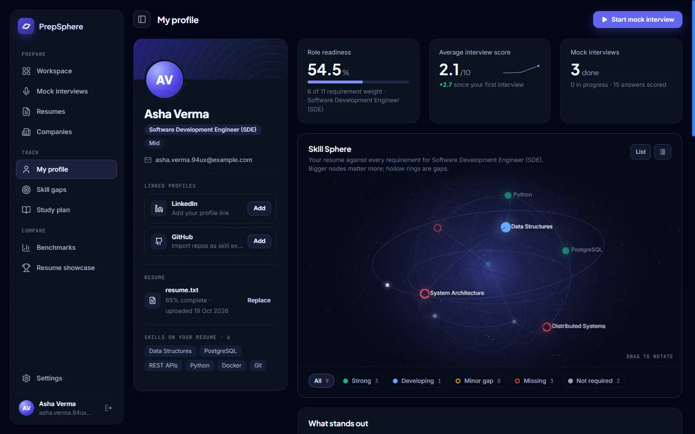
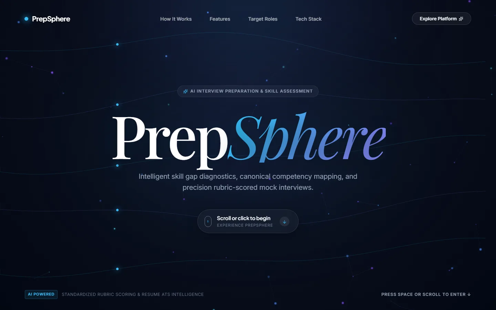
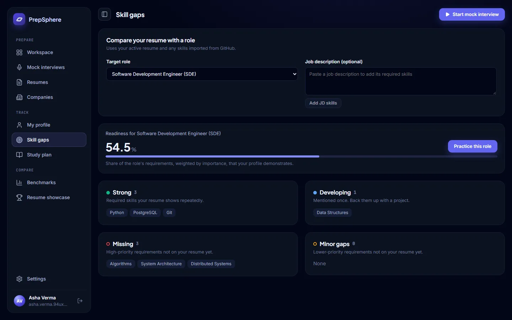
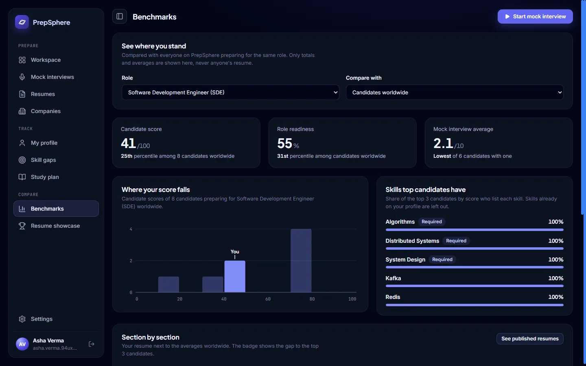
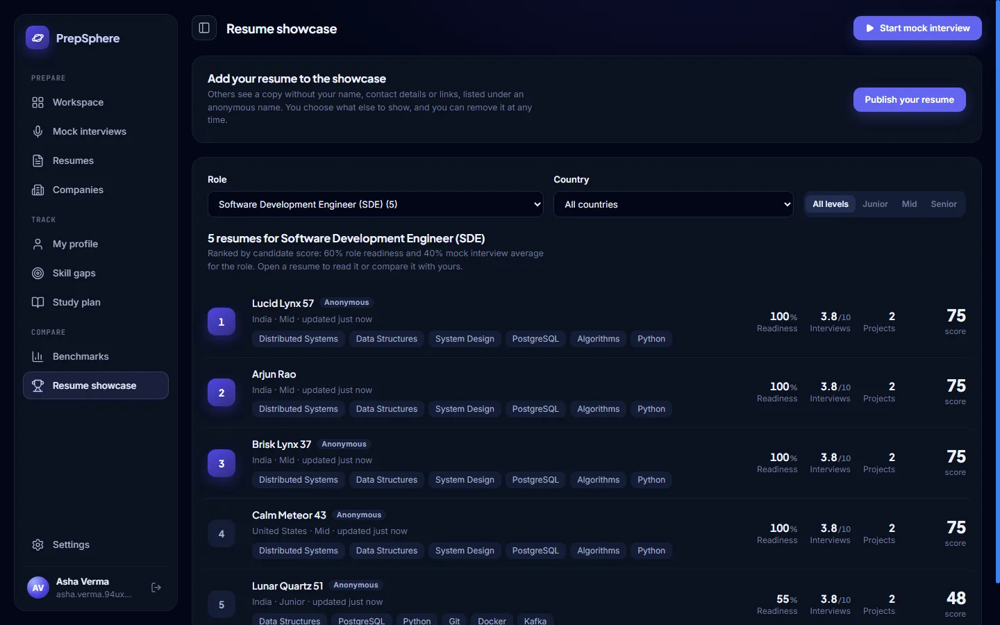
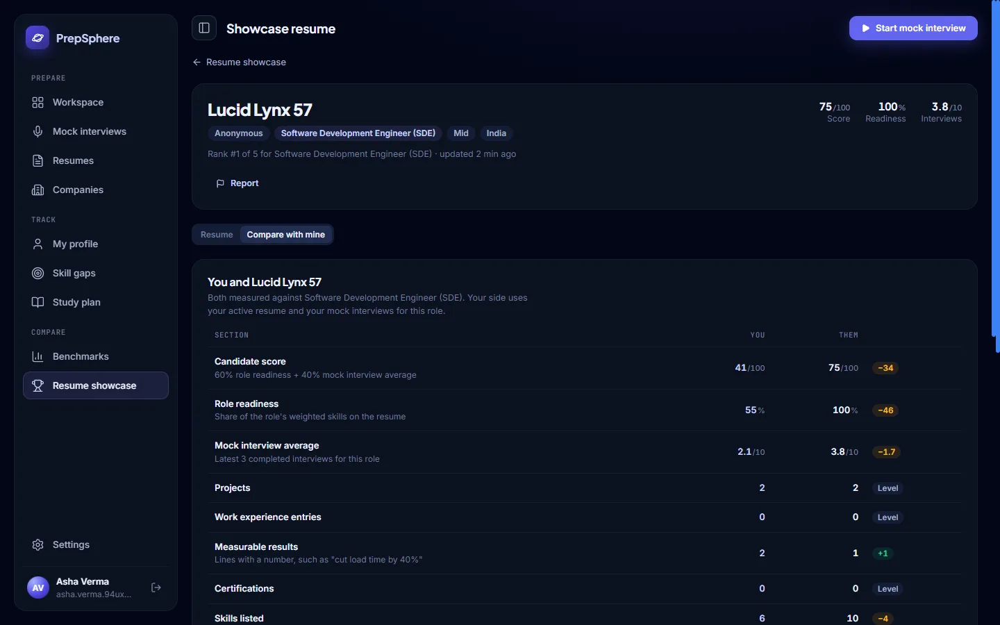

<div align="center">


# PrepSphere

**AI interview preparation and skill assessment for engineering candidates**

[](backend/requirements.txt)
[](backend/)
[](frontend/package.json)
[](backend/services/gemini_service.py)
[](LICENSE)



</div>

PrepSphere helps engineering candidates find out how ready they are for a specific role, and then practise for it: upload a resume, see the skill gap, take text or video mock interviews with AI feedback, and see how you compare with other candidates.

**Developed by [Kshitij Chaurasia](https://github.com/Kshitij-0567), based on the original project by [Karan Shelar](https://github.com/Edge-Explorer).**

## Contents

- [Features](#features)
- [Screenshots](#screenshots)
- [Tech stack](#tech-stack)
- [Quick start](#quick-start)
- [Configuration](#configuration)
- [Testing](#testing)
- [Project structure](#project-structure)
- [API overview](#api-overview)
- [Documentation](#documentation)
- [History](#history)
- [License](#license)

## Features

1. **Pick a role** from 34 engineering roles across software, AI/data, cloud, hardware/VLSI, robotics and core engineering, choose a seniority level, and optionally paste a real job description.
2. **Pick a target company** (350+ companies with interview focus areas, rounds and prep tips) or practise against a general standard.
3. **Upload a resume** (PDF, DOCX or TXT). Skills are extracted with evidence, and the resume gets a completeness check.
4. **See the skill gap**: every role requirement is marked strong, developing, minor gap or missing, with a readiness score weighted by importance.
5. **Take a mock interview**, either as text (5 typed answers) or as video. Questions are generated from the role, company, seniority, resume and gaps; each answer is scored against a rubric.
   - The **video interview** runs a plan of spoken, coding and whiteboard steps chosen for the role family and seniority (no coding round for core engineering roles).
   - The interviewer speaks each question in a browser voice, listens to the answer with live captions, and may ask up to two follow-ups.
   - Coding happens in an editor; system design on an Excalidraw whiteboard that the AI reviews as an image.
6. **Get results**:
   - per-question feedback and which expected concepts you covered
   - a prioritized study plan
   - for video interviews: a replay of each answer, a transcript with filler words marked, line-by-line code review, and delivery feedback (speaking pace, filler words, long pauses and eye contact)
7. **Compare with other candidates**:
   - **Benchmarks** show your percentile among everyone preparing for the same role, worldwide or in one country, the skills most top candidates have that you don't, and your resume section by section against the averages. Nobody's resume is shown, and a figure only appears when at least 5 candidates stand behind it.
   - The **Resume showcase** ranks resumes their owners chose to publish, by role, country and level. Publishing makes a redacted copy: name (unless chosen), email, phone, links and address are always removed, and college and company names are hidden by default. The owner sees the exact copy before it goes live and can remove it at any time. Any published resume can be compared side by side with your own, and reported; three reports hide it.
   - Both rank by one **candidate score**: 60% role readiness plus 40% of the average of your latest 3 mock interviews for the role, so a keyword-stuffed resume cannot top the list on its own. Demo accounts are left out.

Video recordings never leave the browser; they are kept in IndexedDB for the last 5 interviews. Each answer's audio is sent only to be transcribed and is not stored.

AI features use Google Gemini. Without a `GEMINI_API_KEY` the app still works end to end with deterministic fallbacks, and those scores are clearly labelled *approximate* in the UI.

## Screenshots

| Landing page | Skill gap for a role |
| --- | --- |
|  |  |
| **Benchmarks** | **Resume showcase** |
|  |  |
| **Side-by-side comparison** | |
|  | |

*Screenshots use fictional sample candidates.*

## Tech stack

| Layer | Technology |
| --- | --- |
| Frontend | React 19, Vite, React Router, Framer Motion, Axios; CodeMirror 6, Excalidraw and MediaPipe Face Landmarker (loaded only in the video interview room) |
| Backend | FastAPI, SQLAlchemy 2, Alembic, Pydantic 2 |
| Database | SQLite by default; PostgreSQL supported via `DATABASE_URL` |
| AI | Google Gemini (`google-genai`, async, with timeouts and model fallback) |
| Auth | Email/password (bcrypt + JWT), optional Google Sign-In, private demo accounts |

## Quick start

**Prerequisites:** Python 3.11+, Node.js 20+.

### Backend

```bash
cd backend
python -m venv venv
# Windows: .\venv\Scripts\activate     macOS/Linux: source venv/bin/activate
pip install -r requirements.txt
cp .env.example .env        # then set SECRET_KEY (required) and optionally GEMINI_API_KEY
python main.py              # http://127.0.0.1:8000  (API docs at /docs)
```

On startup the backend applies database migrations automatically and syncs the role and company catalog. An existing SQLite database is backed up (`interview_prep.db.backup-<revision>`) before any migration runs.

### Frontend

```bash
cd frontend
npm install
cp .env.example .env        # VITE_API_URL=http://localhost:8000
npm run dev                 # http://localhost:5173
```

### Docker (single container, API + frontend)

```bash
docker compose up --build   # http://localhost:8000
```

Data is stored in the `prepsphere-data` volume. Secrets come from `backend/.env` at runtime and are never copied into the image.

## Configuration

Backend (`backend/.env`, see `backend/.env.example`):

| Variable | Required | Purpose |
| --- | --- | --- |
| `SECRET_KEY` | yes | Signs login tokens. Generate with `python -c "import secrets; print(secrets.token_urlsafe(48))"` |
| `DATABASE_URL` | no | Defaults to `backend/interview_prep.db` (SQLite) |
| `ACCESS_TOKEN_EXPIRE_MINUTES` | no | Login lifetime, default 1440 (24 h) |
| `GEMINI_API_KEY` | no | Enables AI questions, evaluation and recommendations |
| `GEMINI_MODEL` / `GEMINI_FALLBACK_MODEL` | no | Default `gemini-3.6-flash`, falling back to `gemini-flash-latest` |
| `GEMINI_TIMEOUT_SECONDS` | no | How long to wait for one Gemini response, default 30 |
| `GOOGLE_CLIENT_ID` | no | Enables Google Sign-In (must match the frontend's `VITE_GOOGLE_CLIENT_ID`) |
| `GITHUB_TOKEN` | no | Raises the GitHub profile-import limit from 60 to 5,000 requests per hour (no scopes needed) |
| `APP_ENV` | no | `development` (default) or `production`. Production hides the API docs, turns demo login off unless enabled, sends HSTS and refuses unsafe settings. The Docker image sets it. |
| `CORS_ORIGINS` | no | Comma-separated allowed frontend origins. `*` is refused; production origins must be `https://`. |
| `DEMO_LOGIN_ENABLED` | no | "Try a demo" button. On in development, off in production unless set to `true`. |
| `ENABLE_API_DOCS` | no | Interactive docs at `/docs`. On in development, off in production. |
| `RATE_LIMITS_ENABLED` | no | Per-address and per-account request limits, default `true` |
| `FORWARDED_ALLOW_IPS` | no | Behind a reverse proxy, the proxy's IP address, so rate limits apply per visitor |
| `MAX_RESUME_MB` | no | Upload size limit, default 10 |
| `MAX_ANSWER_AUDIO_MB` | no | Size limit for one video-interview answer's audio, default 16 (about 8 minutes of 16 kHz WAV) |
| `RELOAD` | no | `true` restarts `python main.py` when code changes (development only) |
| `HOST` / `PORT` | no | Where `python main.py` listens, default `127.0.0.1` and `8000` |
| `RUN_MIGRATIONS_ON_STARTUP` | no | Apply database migrations when the app starts, default `true`. Turn off only if you run `alembic upgrade head` yourself |
| `STATIC_DIR` | no | Folder with the built frontend for the backend to serve. The Docker image sets it |

Frontend (`frontend/.env`): `VITE_API_URL`, `VITE_GOOGLE_CLIENT_ID`. Never put secrets in `VITE_` variables; they are embedded in the public bundle.

## Testing

```bash
cd backend && pip install -r requirements-dev.txt && pytest
cd frontend && npm run lint && npm run build
```

The backend suite covers auth, resume upload and skill gaps, the full interview flow, AI fallbacks, the skill taxonomy, benchmarks and the showcase (including redaction), and migrations. It runs against a throwaway SQLite database with no API keys. CI runs the same checks on every push and pull request.

## Project structure

```
.github/                     CI (tests, lint, build), CodeQL, Dependabot, issue and pull request templates
docs/
  ARCHITECTURE.md            how the system works: components, data model, main flows, security
  screenshots/               images used in this README
backend/
  main.py                    FastAPI app and all endpoints
  auth/                      password hashing, JWT tokens, current-user dependency
  core/                      config, database, models, schemas, migrations runner, seed data, countries
  services/
    gemini_service.py        question generation, rubric evaluation, recommendations (+ fallbacks)
    resume_intelligence.py   text extraction, contact info, structure, completeness
    jd_intelligence.py       job description requirements
    skill_taxonomy.py        skill catalog, aliases, evidence extraction, role-requirement matching
    skill_gap.py             weighted readiness and strong/developing/gap statuses
    candidate_profile.py     the active resume and the skills derived from it
    interview_plan.py        video interview step plans by role family and seniority
    video_interview.py       video step questions, one-call transcription + scoring, follow-ups (+ fallbacks)
    delivery.py              speaking pace, filler words, pauses and eye contact
    benchmarks.py            cohorts per role and country, percentiles, top-candidate skills, candidate score
    showcase.py              redacted published resumes, ranking, side-by-side comparison, reports
  migrations/                Alembic migrations
  tests/                     pytest suite
frontend/src/
  api/                       Axios client (auth header, session expiry) and session helpers
  components/                app shell (sidebar layout), toasts and tooltips, shared widgets
  styles/app.css             design tokens and shared classes for signed-in pages
  pages/Dashboard.jsx        workflow state; one component per step in pages/dashboard/
  pages/profile/             profile page widgets, including the 3D skill sphere
  pages/interview/           video interview: setup check, interview room, results; lib/ has media, speech,
                             recordings (IndexedDB), face tracking and the room controller
  pages/showcase/            benchmarks, the showcase leaderboard, publishing with a live preview, comparison
  pages/LandingPage.jsx, Login.jsx, Signup.jsx
frontend/public/models/      MediaPipe face model, served from the site
```

## API overview

| Method & path | Purpose |
| --- | --- |
| `POST /auth/signup`, `/auth/login`, `/auth/google`, `/auth/demo` | Authentication |
| `GET /roles`, `GET /companies` | Role and company catalogs |
| `POST /resumes/upload`, `GET /resumes`, `POST /resumes/{id}/select`, `DELETE /resumes/{id}` | Resume library (one resume is active) |
| `POST /jobs/analyze` | Extract requirements from a job description |
| `GET /skill-gaps?role_id=&jd_skills=` | Skill gap for the active resume |
| `POST /interviews`, `POST /interviews/{id}/answers`, `GET /interviews/{id}/results` | Mock interview (`mode`: `text` or `video`) |
| `GET /roles/{id}/video-plan`, `POST /interviews/{id}/video-answers`, `POST /interviews/{id}/finish`, `POST /interviews/{id}/resume` | Video interview plan, multipart answers (audio, code, whiteboard PNG), ending early, resuming |
| `GET /interviews/history`, `GET /recommendations` | History |
| `GET /countries`, `PATCH /users/me` (`country`) | Country list; the user's country |
| `GET /benchmarks?role_id=&country=` | Percentiles and averages for a role, worldwide or in one country |
| `GET /showcase/me`, `POST /showcase/preview`, `PUT /showcase`, `DELETE /showcase` | Your published resume: preview, publish or update, remove |
| `GET /showcase?role_id=&country=&seniority=`, `GET /showcase/{id}`, `GET /showcase/{id}/compare`, `POST /showcase/{id}/report` | Leaderboard, one published resume, comparison with yours, reporting |

Interactive documentation is available at `http://127.0.0.1:8000/docs`.

## Documentation

| Document | What it covers |
| --- | --- |
| [docs/ARCHITECTURE.md](docs/ARCHITECTURE.md) | Components, data model, the main flows step by step, scoring, privacy and security |
| [backend/README.md](backend/README.md) | Backend layout, every service module, database migrations |
| [frontend/README.md](frontend/README.md) | Frontend layout and scripts |
| [CONTRIBUTING.md](CONTRIBUTING.md) | Setting up, making a change, checks to run before a pull request |
| [SECURITY.md](SECURITY.md) | Reporting vulnerabilities, handling secrets and personal data |

## History

PrepSphere grew out of an earlier prototype, InterviewAI, which used LangGraph research agents, a JSON company registry and multi-round voice interviews. That code and its design documents are no longer used by the app; they are preserved in the git history.

## License

MIT, see [LICENSE](LICENSE).
