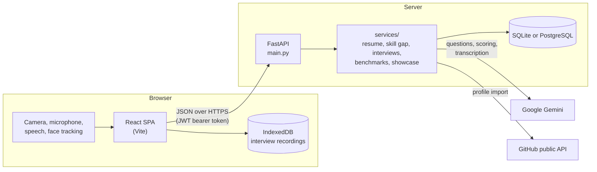
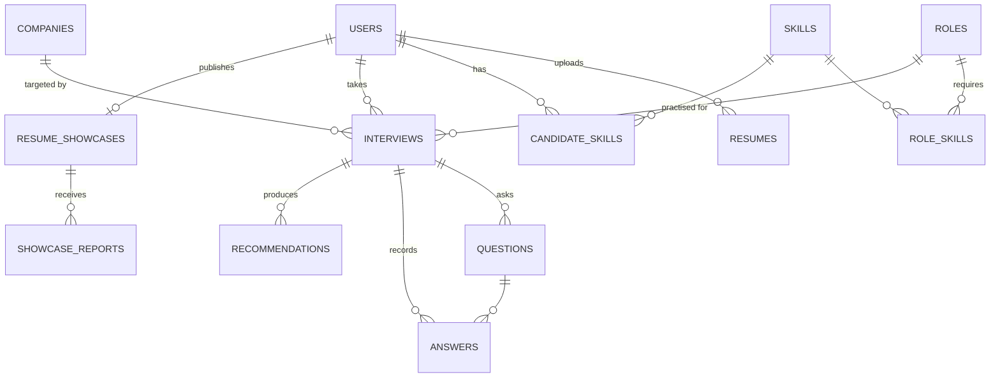

# Architecture

This document explains how PrepSphere is put together: the moving parts, the data they keep, and what happens during each main flow. For setup and the API list, see the [README](../README.md).

## System overview



- **One backend process** serves every endpoint. In production (Docker) it also serves the built frontend, so both share one origin.
- **The database** is SQLite by default and PostgreSQL through `DATABASE_URL`. Alembic migrations run automatically at startup, and a SQLite file is copied to `interview_prep.db.backup-<revision>` before any migration touches it.
- **Gemini is optional.** Every AI call has a deterministic fallback, and results produced by a fallback are labelled so the UI can mark them as approximate. The test suite runs entirely on the fallbacks.
- **Video and audio stay in the browser** except for the audio of one answer at a time, which is sent for transcription and scoring and then discarded. Recordings for replay live in IndexedDB on the user's device.

## Data model



| Table | What it holds |
| --- | --- |
| `users` | Account, optional Google sign-in, linked LinkedIn/GitHub, cached GitHub import, country |
| `resumes` | Extracted text, parsed sections, skills and completeness. Exactly one per user is *active*. |
| `candidate_skills` | Skills derived from the active resume (`source = resume`) and from GitHub (`source = github`) |
| `roles`, `skills`, `role_skills` | The role catalog: 34 roles, each with weighted skill requirements |
| `companies` | 350+ companies with interview focus areas, rounds and prep tips |
| `interviews`, `questions`, `answers` | Mock interviews. Video interviews add a step `plan`, follow-up questions (`parent_id`), transcripts, code, whiteboard images and delivery metrics. |
| `recommendations` | Study-plan items produced when an interview finishes |
| `resume_showcases`, `showcase_reports` | Redacted published resumes, and reports from other users |

## Main flows

### Resume upload and skill profile

1. `POST /resumes/upload` extracts text from the PDF, DOCX or TXT file.
2. `resume_intelligence.py` finds contact details and links with regular expressions. It reads sections (education, projects, experience, certifications) with Gemini, or with rules when Gemini is unavailable, and scores completeness.
3. `skill_taxonomy.py` extracts skills along with the sentence that proves each one, avoiding everyday-word false positives.
4. The new resume becomes the **active** one (`candidate_profile.py`), and the user's resume-derived skills are rebuilt from it. Skills imported from GitHub are kept separately and added on top.

### Skill gap

`skill_gap.py` compares the candidate's skills with a role's weighted requirements, optionally adding skills from a pasted job description.
- **Readiness** is the share of requirement weight that the profile covers.
- **Statuses:** strong (mentioned twice or more), developing (mentioned once), missing (a high-importance requirement with no match), or minor gap.

### Text mock interview

1. `POST /interviews` creates the interview and generates the first question from:
   - the role, company, seniority and job description
   - the active resume
   - the candidate's weakest skills
2. Each `POST /interviews/{id}/answers` scores the answer against a rubric (correctness, relevance, completeness, and which concepts were covered or missed) and generates the next question with the conversation so far as context.
3. After the fifth answer the interview completes, and recommendations are generated for the study plan.

### Video mock interview

1. `interview_plan.py` builds a plan of steps for the role family and seniority: spoken questions, a coding problem and a system-design whiteboard. Core engineering roles get no coding round.
2. In the browser, the room controller (`pages/interview/lib/roomController.js`) runs the session:
   - It speaks each question with the Web Speech API.
   - It records camera and microphone with MediaRecorder.
   - It shows live captions.
   - It tracks eye contact with MediaPipe Face Landmarker.
3. Each answer is sent as one multipart request (`POST /interviews/{id}/video-answers`). The request carries:
   - the audio, re-encoded to 16 kHz WAV
   - the code
   - a PNG of the whiteboard
   - the captions
   - delivery measurements
4. `video_interview.py` asks Gemini, in a single call, to transcribe the audio, score the answer and optionally suggest a follow-up question (at most two per step).
5. `delivery.py` turns timings into speaking pace, filler words, long pauses and eye contact. Pace is only computed from a real transcript of at least 10 seconds.

### Benchmarks and the resume showcase

**Candidate score.** Both features rank people by the same score, computed in `benchmarks.py`:

```
candidate score = 0.6 × role readiness (0–100)
                + 0.4 × average of the latest 3 completed mock interviews for the role (0–10, scaled to 0–100)
```

A missing interview counts as 0, so a resume full of keywords cannot reach the top on its own.

**Benchmarks** compare a user with the *cohort* for a role: everyone with an active resume who has started at least one interview for it. Demo accounts are excluded.
- The cohort can be narrowed to one country.
- Results include percentiles, a score histogram, skills common among the top 10%, and section-by-section averages.
- **Privacy:** nothing is reported unless at least 5 other candidates are in the cohort, and every average or skill share needs at least 3 people behind it.

**The showcase** (`showcase.py`) publishes a redacted copy of the active resume.
- Free text is scrubbed of:
  - emails, phone numbers, links and handles
  - the owner's name, email and profile links wherever they appear
  - college and company names when the owner hides them, which is the default
- The owner previews exactly what will be published, and can update or remove it at any time.
- Readiness is recomputed from the copy's skills, and the interview average is read live, so the ranking stays current.
- Three reports from different users hide a showcase until its owner publishes a changed version.

## Security notes

- **Passwords** are hashed with bcrypt (cost 12) over a SHA-256 digest, which avoids bcrypt's 72-byte limit. A sign-in for an unknown email still runs a full bcrypt check, so response times don't reveal which emails have accounts.
- **Login tokens** are HS256 JWTs (PyJWT) signed with `SECRET_KEY`. The algorithm is fixed when verifying, and tokens must carry an expiry and a subject. The app refuses to start without a key, and in production the key must be at least 32 characters.
- **Access control.** Every endpoint that takes a record ID checks that the record belongs to the caller and answers 404 otherwise. Only the role, company and country catalogs are public.
- **Google sign-in** verifies the ID token's audience against `GOOGLE_CLIENT_ID`.
- **Rate limits** (`core/security.py`), counted in memory per server process:
  - all routes: 1,200 requests a minute per IP address
  - sign-in: 20 a minute per address, and 10 failed attempts per account in 15 minutes
  - sign-up: 30 per 10 minutes per address; demo accounts: 10 per 10 minutes
  - per account: AI calls, uploads, GitHub imports, publishing and reports
- **Request size.** Bodies over the largest allowed upload plus 6 MB are refused before they are read, whether or not they declare a length.
- **Security headers** on every response: `X-Content-Type-Options`, `X-Frame-Options: DENY`, `Referrer-Policy` and a `Permissions-Policy` limiting the camera and microphone to this site.
  - Pages get a Content-Security-Policy listing exactly the outside sources the app uses (Google Fonts, Google sign-in, HTTPS images), with no inline or evaluated scripts.
  - API responses get a "load nothing" policy and `Cache-Control: no-store`.
  - Production adds HSTS.
- **CORS** allows only `CORS_ORIGINS` (a `*` is refused), only the methods and headers the frontend uses, and no cookies: tokens travel in the `Authorization` header, so CSRF does not apply.
- **Uploads.**
  - Resumes are parsed in memory and never written to disk.
  - PDFs are read up to 30 pages, and a `.docx` that would expand past 50 MB is refused (zip bombs).
  - Parser errors are logged, not shown to users.
  - Whiteboard images must be real PNGs, and audio must be an allowed type.
- **Input.** Requests are validated by Pydantic with length limits. Display names, the one free text other users see, are cleaned of invisible characters and may not contain markup characters or start a spreadsheet formula. React escapes all text, and the frontend has no raw-HTML rendering.
- **Prompt injection.** Text written by candidates or copied from documents is wrapped in `<<<…>>>` blocks, and every prompt tells the model never to follow instructions inside them.
- **Production mode** (`APP_ENV=production`, set by the Docker image) hides the API docs, turns off demo login unless enabled, disables auto-reload and refuses unsafe settings.
- **Demo accounts** are private and throwaway. They cannot publish or report resumes, and they never appear in benchmarks.
- **Secrets** live only in `backend/.env`, which git and Docker both ignore. `VITE_` variables are public by design and must never hold secrets.

## Testing

- **Backend** (`backend/tests`, pytest) runs against a throwaway SQLite database with no API keys. It covers:
  - authentication and resume upload
  - the skill taxonomy and skill gaps
  - text and video interview flows, including AI fallbacks
  - the profile summary
  - benchmarks and the showcase, including redaction
  - migrations: the migrated schema must match the models exactly
- **Frontend** is checked by ESLint and a production build.
- **CI** (`.github/workflows/ci.yml`) runs both on every push and pull request.
